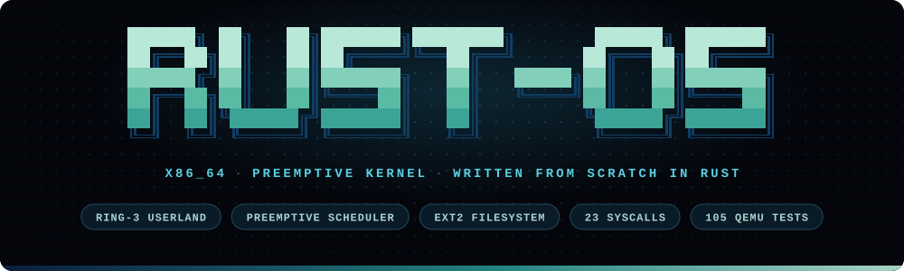
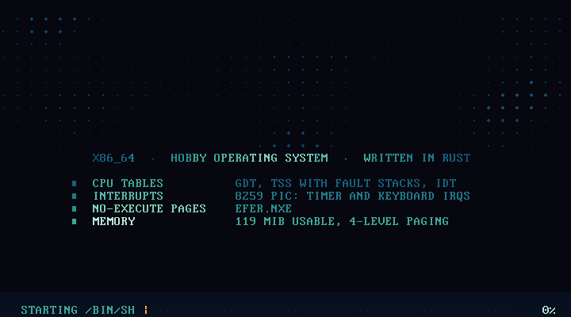
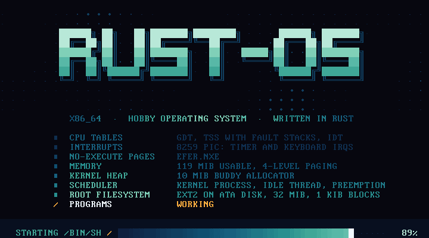
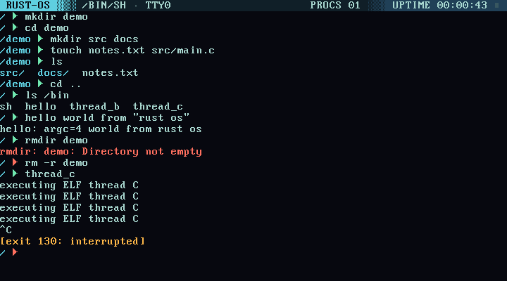
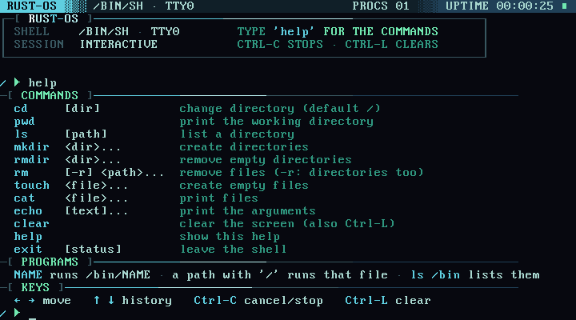
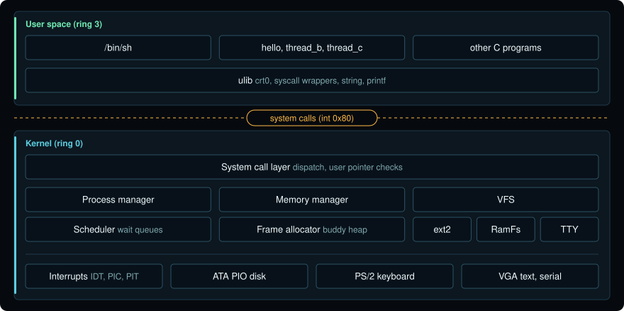

<div align="center">



RUST-OS boots into a Unix-like shell that runs in user mode (ring 3). The shell launches
C programs from an ext2 disk, and those programs talk to the kernel through Linux-style system calls.

<p>
  <a href="https://github.com/zelencik-m/RUST-OS/actions/workflows/ci.yml"></a>
  
  
  
  
</p>



<sub>Recorded live from QEMU: the animated boot screen, then a shell session that creates
directories, runs programs from <code>/bin</code> with arguments, shows an error, and stops a running program with Ctrl-C.</sub>

</div>

---

## Highlights

- **Preemptive multitasking:** processes and threads, a round-robin scheduler driven by the timer interrupt, sleep and wait queues, and context switches written in assembly.
- **Memory management:** 4-level paging, a separate address space per process, VMAs, demand paging, stack guard pages, no-execute (NX) pages, and `brk`/`mmap`/`munmap`. The kernel heap runs on a buddy allocator.
- **User mode (ring 3):** an ELF64 loader, separate user and kernel stacks (TSS), a System V argc/argv initial stack, and an `int 0x80` syscall interface that validates every user pointer.
- **23 system calls:** Linux numbering for `read`, `write`, `open`, `getdents64`, `mkdir`, `unlink`, `chdir`, `wait4`, `mmap` and others, plus custom ones for `spawn`, terminal modes and foreground process control.
- **Filesystems:** a VFS layer with an in-memory RamFs and a read/write **ext2** driver (indirect blocks, block and inode bitmaps, directory entry removal) on top of an ATA PIO disk driver.
- **Process lifecycle:** `spawn` + `wait4`, exit codes, zombie processes and reparenting, and **Ctrl-C** that stops a process only at a safe point, so it never dies holding a lock.
- **Terminal:** a TTY with cooked and raw modes and a line discipline that never allocates in the keyboard interrupt. The VGA text console supports ANSI escape sequences, UTF-8 and custom color palettes.
- **Userland:** a small libc written for this project (`crt0`, syscall wrappers, `string.h`, `printf`) and a **shell** with line editing, history, builtins and program execution.
- **Tests:** 18 integration test suites (105 test cases) that each boot a real kernel in QEMU, plus 11 C programs that test the kernel from ring 3. All of them run in GitHub Actions on every push.

<p align="center">
<sub>~12,000 lines of kernel Rust · ~4,500 lines of tests · ~3,000 lines of C userland</sub>
</p>

---

## Screenshots

<table>
  <tr>
    <td width="50%"></td>
    <td width="50%"></td>
  </tr>
  <tr>
    <td align="center"><b>Boot screen:</b> every init step is reported live while a background thread mounts the disk</td>
    <td align="center"><b>Shell:</b> filesystem commands, a program run with arguments, error messages, and Ctrl-C</td>
  </tr>
  <tr>
    <td colspan="2"></td>
  </tr>
  <tr>
    <td colspan="2" align="center"><b>Built-in help:</b> the status bar on the top row shows the process count and uptime, and the colors come from a reprogrammed VGA palette</td>
  </tr>
</table>

<!--
  Optional: a longer, narrated demo video. Upload the .mp4 by dragging it into a
  GitHub issue/PR comment or the README editor on github.com, then paste the
  generated https://github.com/user-attachments/assets/... URL on its own line here.
-->

---

## Architecture

<p align="center">
  
</p>

The kernel is a single `no_std` crate (`src/lib.rs`). It is booted by the
[`bootloader`](https://github.com/rust-osdev/bootloader) crate and run in QEMU with
[`bootimage`](https://github.com/rust-osdev/bootimage). User programs reach the kernel only through
`int 0x80`, and each process runs in its own address space.

---

## Features in depth

### Processes, threads and scheduling
- **Process and thread model:** a process owns its address space, file descriptors, working directory and child list. Threads own a kernel stack and a saved CPU context. PIDs and TIDs are reused after they are freed.
- **Preemption:** the PIT timer interrupt ends a thread's time slice. A context switch saves the callee-saved registers and `rflags` in a small assembly routine, and the kernel switches `CR3` whenever the next thread belongs to a different process.
- **Sleeping and blocking:** `sleep(ticks)` uses a min-heap of deadlines. `WaitQueue::wait_until(condition)` blocks until an event happens (a key press, a child exiting) and avoids lost wakeups by checking the condition and going to sleep with interrupts disabled.
- **Concurrency rules:** all locks are taken in one global order (TTY → SCHEDULER → PROCESS_MANAGER → MEMORY_MANAGER), and an `IrqSafeMutex` disables interrupts while it is held so an interrupt handler can't deadlock on it. Threads that exit are cleaned up later by a reaper rather than by themselves.

### Memory
- **Physical memory:** a frame allocator built from the bootloader's memory map that also frees frames, and a kernel heap backed by a **buddy allocator** (bump and fixed-size-block allocators are also implemented).
- **Virtual memory:** every process has its own P4 page table, with the kernel mappings shared between all of them. Each address space keeps a list of VMAs (code, data, heap, stack, mmap, guard). Pages are mapped on the first fault (**demand paging**). A fault on a guard page is reported as a stack overflow, and a fault outside every VMA kills the process with a segfault exit code instead of crashing the kernel.
- **Protection:** NX is enabled through `EFER.NXE`, ELF segments get only the permissions they ask for, and every user pointer passed to a syscall is checked to be canonical and inside the user range before it is copied.

### Syscalls and userland
- Syscalls use `int 0x80` with the Linux x86_64 register convention and syscall numbers, so the C code reads like ordinary POSIX code.
- **`spawn(path, argv)` + `wait4`** instead of fork/exec. A child inherits the working directory and shares stdin, stdout and stderr with its parent, including their file offsets.
- **Ctrl-C:** the keyboard interrupt only marks the foreground process as killed. The process exits itself at the next safe point (the end of a syscall, or a timer tick that interrupted user code). Blocking calls return `EINTR`.
- **`ulib`:** `crt0` (`_start` → `main` → `exit`), syscall wrappers that return `-errno`, `string.h` and `mem*` functions, and a `printf` family that handles widths, padding and 64-bit values.
- **`/bin/sh`:** `cd pwd ls mkdir rmdir rm -r touch cat echo clear help exit`, quoted arguments, `#` comments, ←/→ cursor movement, ↑/↓ history, Ctrl-L to clear the screen, and a script mode used when stdin is a file. If the shell exits, a kernel supervisor thread starts a new one.

### Storage
- **VFS:** path resolution with `.` and `..`, a per-process working directory, and file descriptors with offsets. Device files (the console) are inodes too.
- **ext2:** reads and writes files through direct and indirect blocks, creates and deletes files and directories, and keeps the superblock, block group descriptors and bitmaps up to date. A test checks that the free block and inode counts return to their original values after every operation.
- **ATA PIO driver** for the secondary IDE disk. At every boot the kernel installs its built-in programs into `/bin`, so programs are loaded from the disk, not from memory.

### Console and boot experience
- **TTY** with cooked mode (line editing, echo, `^C`, `^D` for end of file) and raw mode (arrow keys arrive as `ESC [ A`…). It uses fixed-size ring buffers, so the keyboard interrupt never allocates.
- **VGA text terminal:** scrolling, `\r`, `\b`, `\t`, form feed, ANSI colors and cursor movement, and UTF-8 → CP437 translation so programs can draw box characters.
- **Custom look:** the VGA DAC palette is reprogrammed (`src/theme.rs`), with a 14-step gradient for the boot screen and a separate palette for the terminal. A status bar is refreshed by its own kernel thread.
- **Leveled kernel log on serial** (`error`…`trace`) with timestamps. It is safe to call while the scheduler lock is held.

---

## Testing

Each file in `tests/` is its own `no_std` test kernel. It boots in QEMU, runs its
`#[test_case]`s, reports the results over serial and exits QEMU through the `isa-debug-exit` device.

| Area | Suites |
|---|---|
| Memory | `heap`, `buddy_allocator`, `frame_allocator`, `memory`, `uaccess`, `kernel_fault` |
| Scheduling & processes | `scheduler_stress`, `sleep_lock`, `process_lifecycle`, `initial_stack` |
| Filesystems | `filesystem` (RamFs), `ext2` (real disk), `install` |
| Terminal | `tty`, `tty_blocking` |
| Userspace | `userspace`, `elf_images`, `basic_boot` |

The **`userspace`** suite runs 11 C programs in ring 3 under the real ELF loader and
scheduler. They test syscalls, NX, ring-3 exceptions, the VFS, `spawn`/`wait4`, Ctrl-C,
`printf`, and the shell itself, both from a script and by typing keys including arrow keys.
Every test suite runs in **GitHub Actions** on each push and pull request.

```bash
cargo test                      # all suites (each one boots its own QEMU)
cargo test --test userspace     # a single suite
```

---

## Getting started

**Requirements:** the nightly Rust toolchain pinned in `rust-toolchain.toml` (installed automatically by `rustup`),
QEMU, Clang (to compile the C programs) and `bootimage`.

```bash
# macOS:   brew install qemu llvm
# Ubuntu:  sudo apt install qemu-system-x86 clang
cargo install bootimage

git clone https://github.com/zelencik-m/RUST-OS.git
cd RUST-OS
cargo run        # boots the kernel in QEMU and drops you into /bin/sh
```

Type `help` in the shell to list the commands. The root filesystem is a copy of `ext2.img`
(`target/ext2-disk.img`), so files you create are still there after a reboot. Delete that file to start from a clean disk.

### Writing your own program

```c
#include "ulib.h"

int main(int argc, char **argv) {
    printf("hello: argc=%d", argc);
    for (int i = 1; i < argc; i++) printf(" %s", argv[i]);
    printf("\n");
    return 0;
}
```

Add the file to `PROGRAMS` in `build.rs` and embed it in `src/main.rs`. The kernel installs it into
`/bin` at boot, and you can run it from the shell by name.

---

## Project layout

```
.
├── src/                    the kernel (a single no_std crate)
│   ├── main.rs             entry point: boot screen, /bin install, shell supervisor
│   ├── lib.rs              kernel initialization shared by the binary and the tests
│   ├── interrupts/         GDT, TSS, IDT, 8259 PIC, exception and IRQ handlers
│   ├── memory/             paging, frame allocator, address spaces and VMAs
│   │   ├── allocator/      buddy, bump and fixed-size-block heap allocators
│   │   └── memory_manager/ mmap/brk, page-fault handling, address-space lifecycle
│   ├── process/            processes, threads, ELF loader, argc/argv initial stack
│   │   └── process_manager/ spawn, wait4, exit, kill, context switching
│   ├── scheduler/          round-robin scheduler, sleep heap, wait queues
│   ├── syscall/            int 0x80 entry stub, dispatch, user memory access, errno codes
│   ├── fs/                 VFS, paths, file descriptors, RamFs, console device
│   │   └── ext2/           ext2 driver and on-disk structures (ATA PIO in fs/ata_pio.rs)
│   ├── tty.rs              line discipline: cooked/raw modes, echo, Ctrl-C
│   ├── keyboard.rs         PS/2 scancode decoding
│   ├── vga_buffer.rs       VGA text terminal: scrolling, ANSI, UTF-8 → CP437
│   ├── boot_screen.rs      animated boot screen
│   ├── status_bar.rs       status bar on the top row
│   ├── theme.rs            VGA palettes for the boot screen and the terminal
│   ├── programs.rs         installs and loads programs in /bin
│   ├── sync.rs             IrqSafeMutex
│   ├── serial.rs, debug/   serial output and the leveled kernel log
│   └── task/               async executor from the early tutorial chapters
├── user_programs/          C programs installed into /bin
│   ├── sh.c                the shell
│   ├── hello.c, thread_*.c demo programs
│   ├── ulib/               crt0, syscall wrappers, string functions, printf
│   └── linker.ld           links programs at the user-space load address
├── tests/                  18 test kernels, each booted in its own QEMU
│   ├── support/            shared test runner and helpers
│   └── user_programs/      C programs that test the kernel from ring 3
├── build.rs                compiles the C programs with clang, generates syscall_numbers.h
├── scripts/qemu-runner.sh  cargo runner: gives QEMU a working copy of the disk image
├── ext2.img                32 MiB root filesystem image
├── x86_64-blog_os.json     custom bare-metal target
└── .github/workflows/      CI: runs every test suite in QEMU
```

---

---

## Design decisions and lessons learned

- **Killing a process only at safe points.** If Ctrl-C ended a process in the middle of a syscall, it could leave a lock held or an `Arc` reference never dropped. Marking the process and letting it exit itself at a known safe point avoids this, and it is close to how Linux handles signals.
- **No allocation in interrupt handlers.** The keyboard interrupt path uses only fixed-size ring buffers, and the run queue reserves its capacity at boot. The heap lock is still made safe to take with interrupts disabled, because the timer's reaper frees memory.
- **Large kernel state in `static`s, built with `const fn`.** Kernel stacks are 16 KiB with no guard page, so building large structures on the stack (as `lazy_static` does) can overflow it without any error.
- **ext2 compatibility.** Deleting an inode with a small `dtime` value made `e2fsck` treat it as a link in the ext3 orphan list and report the disk as corrupt. Checking the driver with real Linux tools caught a bug my own tests had missed.
- **Testing from user mode.** Many bugs only appeared when a real ring-3 program used the syscalls, so most features have both a kernel-level test and a C test.


## Acknowledgements

The early boot code (VGA output, interrupts, paging and heap setup) follows Philipp Oppermann's
[*Writing an OS in Rust*](https://os.phil-opp.com/). Everything after that series was designed and written for
this project: processes, threads, scheduling, user mode, syscalls, the VFS, ext2, the TTY, the libc, the shell and the UI.
